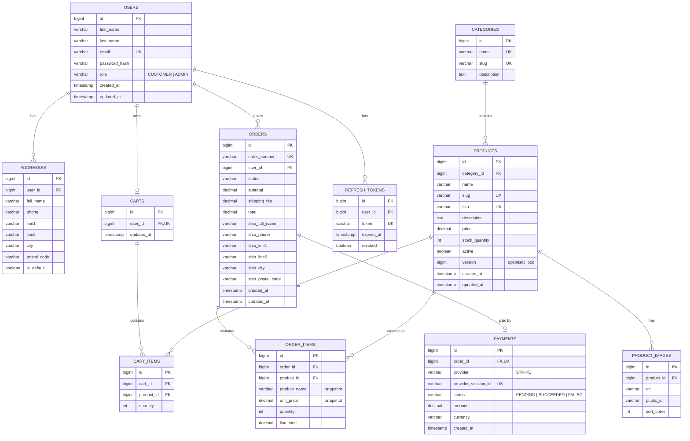

# ShopNest – Architecture & Database Design

## 1. High-Level Architecture

```
[ React SPA ] ──HTTP/JSON──► [ Spring Boot REST API ] ──► [ PostgreSQL ]
                                    │
                                    ├──► Stripe (payments + webhooks)
                                    └──► Cloudinary (product images)
```

Style: **modular monolith**, a single deployable app organised by feature.

## 2. Backend Layers
Controller → (DTO) → Service → Repository → Entity → Database

- **Controller:** HTTP only (routing, validation, status codes)
- **Service:** business rules, transactions (`@Transactional`)
- **Repository:** Spring Data JPA interfaces
- **DTOs:** API contracts; entities are never exposed directly
- **Mapper:** MapStruct converts Entity ↔ DTO

## 3. Package Structure (feature-based)

```
com.shopnest
├── ShopNestApplication.java
├── common/        # exceptions, error handler, base entity, pagination DTOs
├── config/        # security, OpenAPI, CORS, Cloudinary, Stripe config
├── security/      # JWT service, filter, UserDetails
├── auth/          # register, login, refresh, logout
├── user/          # User entity, profile
├── address/
├── category/
├── product/
├── cart/
├── order/
├── payment/
└── admin/         # dashboard
```
Each feature has: `controller`, `service`, `repository`, `entity`, `dto`, `mapper`.

## 4. Database Design (ER Diagram)



### Key design decisions
- **Snapshot fields** (order items, shipping address): old orders stay correct after prices or addresses change.
- **`version` on products:** optimistic locking prevents overselling.
- **Unique (cart_id, product_id):** one line per product in a cart.
- **Soft delete for products** (`active = false`): products used in old orders can't be hard-deleted.

## 5. Security
- Public: `GET /products/**`, `GET /categories/**`, `/auth/**`, Swagger, Stripe webhook
- CUSTOMER: cart, addresses, own orders, checkout
- ADMIN: `/admin/**`

## 6. Git Workflow
- `main`: stable, always working
- `feature/<name>`: one branch per step, merged into `main` via a Pull Request
- Commit style: Conventional Commits (`feat:`, `fix:`, `docs:`, `chore:`, `test:`)